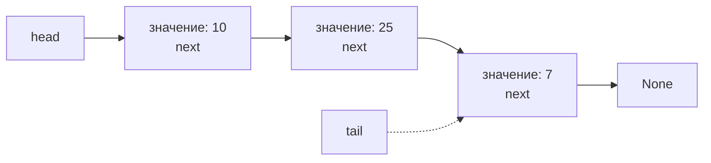
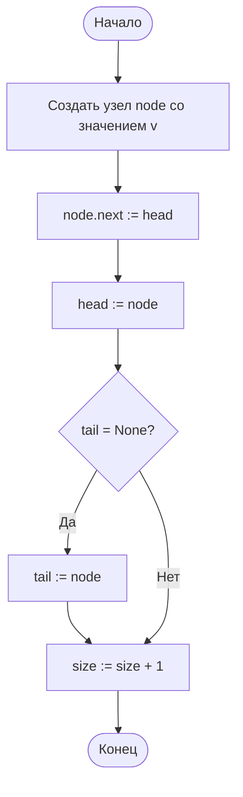
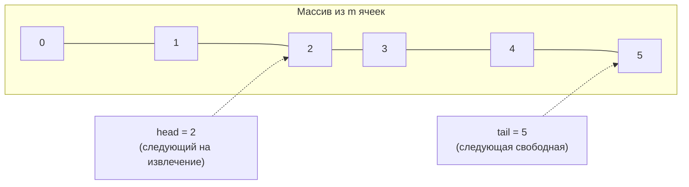

# Лабораторная работа № 6

## Реализация линейных структур данных и анализ трудоёмкости их операций

**Дисциплина:** Теория алгоритмов
**Направление подготовки:** 38.03.05 «Бизнес-информатика»
**Курс:** 2
**Объём:** 4 академических часа
**Язык реализации:** Python 3.10+

---

## 1. Цель и задачи работы

**Цель работы:** изучить линейные структуры данных (стек, очередь, связный список), реализовать их на основе массива и на основе связанных узлов и экспериментально установить, как выбор структуры данных определяет трудоёмкость типовых операций.

**Задачи:**

1. Изучить абстрактные типы данных «стек», «очередь», «дек», «связный список» и их реализации.
2. Реализовать односвязный список с операциями вставки, удаления и доступа по индексу.
3. Реализовать очередь на основе кольцевого буфера и стек на основе динамического массива.
4. Измерить время выполнения операций при росте числа элементов и сопоставить его с теоретическими оценками.
5. Составить сводную таблицу «операция — структура данных» и обосновать выбор структуры для прикладного сценария.

---

## 2. Теоретическая часть

### 2.1. Абстрактный тип данных и его реализация

**Абстрактный тип данных (АТД)** задаёт набор операций и их семантику, но не способ хранения. Одна и та же спецификация допускает разные реализации с разной трудоёмкостью. Это различие между *что* делает структура и *как* она это делает — ключевая идея данной работы [1, 2].

| АТД | Дисциплина обслуживания | Основные операции |
|---|---|---|
| Стек (stack) | LIFO — последним пришёл, первым вышел | `push`, `pop`, `top` |
| Очередь (queue) | FIFO — первым пришёл, первым вышел | `enqueue`, `dequeue`, `front` |
| Дек (deque) | Доступ с обоих концов | Операции с обоих концов |
| Список (list) | Произвольный доступ по позиции | Вставка, удаление, обход |

### 2.2. Реализация на основе массива

Элементы хранятся в непрерывной области памяти. Доступ по индексу выполняется за $\Theta(1)$: адрес элемента вычисляется как $\text{base} + i \cdot \text{size}$.

Недостаток — стоимость вставки и удаления в середине: требуется сдвиг всех последующих элементов, то есть $\Theta(n)$ операций.

**Динамический массив.** При исчерпании ёмкости выделяется новый массив удвоенного размера, и элементы копируются. Отдельная такая операция стоит $\Theta(n)$, однако при удвоении ёмкости суммарные затраты на $n$ вставок в конец составляют $O(n)$. Поэтому **амортизированная** стоимость вставки в конец равна $O(1)$. Именно так устроен тип `list` в Python.

### 2.3. Реализация на основе связанных узлов

Каждый элемент хранится в отдельном узле, содержащем значение и ссылку на следующий узел:

```
head → [ значение | next ] → [ значение | next ] → … → None
```

Вставка и удаление сводятся к переустановке ссылок и выполняются за $\Theta(1)$, **если узел уже известен**. Однако доступ к $i$-му элементу требует прохода от начала списка, то есть $\Theta(i)$.

Разновидности: односвязный, двусвязный (есть ссылка `prev`), кольцевой (последний узел ссылается на первый).

**Накладные расходы.** Узел хранит не только данные, но и ссылку, поэтому расход памяти выше, чем у массива. Кроме того, узлы располагаются в памяти произвольно, что ухудшает использование кэша процессора. По этой причине на практике массив нередко оказывается быстрее связного списка даже там, где асимптотика говорит об обратном.

### 2.4. Кольцевой буфер

Очередь, реализованная как обычный массив, имеет недостаток: при извлечении из начала все элементы нужно сдвигать, что даёт $\Theta(n)$.

В **кольцевом буфере** хранятся два индекса — головы и хвоста, а при достижении конца массива они переходят в его начало:

$$\text{tail} := (\text{tail} + 1) \bmod m.$$

Обе операции выполняются за $\Theta(1)$, дополнительная память не требуется. Кольцевые буферы применяются в системах обработки заявок, журналах событий и буферах ввода-вывода.

### 2.5. Сводная таблица трудоёмкости

| Операция | Динамический массив | Односвязный список | Кольцевой буфер |
|---|---|---|---|
| Доступ по индексу | $\Theta(1)$ | $\Theta(n)$ | $\Theta(1)$ |
| Вставка в конец | $O(1)$ амортизированно | $\Theta(1)$\* | $\Theta(1)$ |
| Вставка в начало | $\Theta(n)$ | $\Theta(1)$ | $\Theta(1)$ |
| Вставка в середину | $\Theta(n)$ | $\Theta(n)$\*\* | — |
| Удаление из начала | $\Theta(n)$ | $\Theta(1)$ | $\Theta(1)$ |
| Поиск значения | $\Theta(n)$ | $\Theta(n)$ | $\Theta(n)$ |
| Память на элемент | Минимальная | Данные и ссылка | Минимальная |

\* При наличии ссылки на хвост списка.
\*\* Сама перестановка ссылок стоит $\Theta(1)$, но поиск нужной позиции требует $\Theta(n)$.

### 2.6. Прикладные сценарии

| Задача | Подходящая структура | Обоснование |
|---|---|---|
| Отмена последнего действия | Стек | Требуется только последний элемент |
| Очередь заявок службы поддержки | Кольцевой буфер | FIFO, обе операции за $\Theta(1)$ |
| Проверка парности скобок в формуле | Стек | Классическое применение LIFO |
| История переходов (вперёд и назад) | Два стека или дек | Доступ с обоих концов |
| Частые вставки в середину журнала | Двусвязный список | Перестановка ссылок вместо сдвига |
| Частые обращения по номеру записи | Массив | Доступ за $\Theta(1)$ |

---

## 3. Порядок выполнения работы

1. Изучить теоретическую часть.
2. Реализовать односвязный список как класс с методами `push_front`, `push_back`, `insert`, `pop_front`, `get`, `find`, `__len__`.
3. Реализовать стек и очередь согласно варианту (табл. 1). Очередь — на основе кольцевого буфера.
4. Проверить корректность работы структур на малых примерах (10–15 элементов) с выводом содержимого.
5. Измерить время выполнения операций из табл. 1 при $n$, изменяющемся согласно варианту, для связного списка и для встроенного `list`.
6. Построить графики и сопоставить их с теоретическими оценками из п. 2.5.
7. Решить прикладную задачу варианта.
8. Оформить отчёт со сводной таблицей.

---

## 4. Варианты заданий

**Таблица 1. Исходные данные**

| № | Структура для реализации | Исследуемые операции | Размеры $n$ | Прикладная задача |
|---|---|---|---|---|
| 0 | Односвязный список, кольцевая очередь | Вставка в начало, в конец, доступ по индексу | 1000; 2000; 4000; 8000 | Проверка парности скобок |
| 1 | Двусвязный список, стек на массиве | Вставка в начало, удаление из начала | 2000; 4000; 8000; 16 000 | Отмена действий (undo) |
| 2 | Односвязный список, стек на списке | Вставка в конец, поиск значения | 1000; 3000; 5000; 10 000 | Перевод числа в двоичную систему |
| 3 | Кольцевой буфер, односвязный список | Постановка и извлечение из очереди | 5000; 10 000; 20 000 | Очередь заявок службы поддержки |
| 4 | Двусвязный список, дек | Вставка с обоих концов | 2000; 4000; 8000 | История переходов «вперёд-назад» |
| 5 | Односвязный список, очередь на списке | Доступ по индексу, удаление из середины | 1000; 2000; 4000 | Журнал операций с правками |
| 6 | Кольцевой список, стек | Обход по кругу, вставка | 1000; 5000; 10 000 | Задача Иосифа Флавия |
| 7 | Односвязный список, кольцевая очередь | Вставка в начало, вставка в конец | 2000; 4000; 8000; 16 000 | Слияние двух упорядоченных списков |
| 8 | Двусвязный список, стек | Удаление из конца, доступ по индексу | 1000; 2000; 4000; 8000 | Проверка вложенности тегов |
| 9 | Стек на массиве, стек на списке | Push и pop | 10 000; 50 000; 100 000 | Вычисление обратной польской записи |
| 10 | Односвязный список, дек | Разворот списка, вставка в начало | 1000; 5000; 10 000 | Проверка строки на палиндром |
| 11 | Кольцевой буфер, список | Постановка, извлечение, переполнение | 5000; 10 000; 20 000 | Буфер последних 100 событий |
| 12 | Односвязный список, очередь | Поиск, удаление по значению | 1000; 2000; 4000 | Удаление дублей из списка клиентов |
| 13 | Двусвязный список, кольцевая очередь | Вставка в середину, обход в обе стороны | 1000; 2000; 4000 | Плей-лист с переходами |
| 14 | Стек, очередь | Реализация очереди **через два стека** | 5000; 10 000; 20 000 | Моделирование потока заявок |
| 15 | Односвязный список, стек | Вставка в конец, разворот | 2000; 4000; 8000 | Проверка корректности выражения |
| 16 | Кольцевой буфер, дек | Вставка с обоих концов | 5000; 10 000; 20 000 | Скользящее окно из 50 значений |
| 17 | Односвязный список, стек | Сортировка вставками **на списке** | 500; 1000; 2000; 4000 | Упорядочение записей журнала |
| 18 | Двусвязный список, очередь | Удаление из начала и из конца | 2000; 4000; 8000 | Планировщик задач |
| 19 | Односвязный список, кольцевой список | Поиск цикла в списке | 1000; 5000; 10 000 | Диагностика ссылочной структуры |
| 20 | Стек на массиве, дек | Push, pop, доступ к вершине | 10 000; 50 000; 100 000 | Калькулятор с приоритетом операций |
| 21 | Односвязный список, очередь | Слияние, разделение списка | 1000; 2000; 4000 | Распределение заявок по двум отделам |
| 22 | Кольцевой буфер, стек | Заполнение, вытеснение старых записей | 5000; 10 000; 20 000 | Журнал последних транзакций |
| 23 | Двусвязный список, стек | Вставка в середину, удаление | 1000; 2000; 4000 | Редактирование строки заказа |
| 24 | Односвязный список, дек | Поиск $k$-го элемента с конца | 1000; 5000; 10 000 | Последние $k$ операций клиента |
| 25 | Стек, очередь | Проверка палиндрома через стек и очередь | 10 000; 50 000; 100 000 | Контроль корректности кода |
| 26 | Кольцевая очередь, список | Циклическое обслуживание | 5000; 10 000; 20 000 | Круговое распределение задач |
| 27 | Односвязный список, стек | Вставка в отсортированный список | 1000; 2000; 4000 | Ведение рейтинга клиентов |
| 28 | Двусвязный список, кольцевой буфер | Вставка в начало и конец | 2000; 4000; 8000 | Лента событий с прокруткой |
| 29 | Односвязный список, очередь | Удаление каждого $k$-го элемента | 1000; 2000; 5000 | Ротация исполнителей |
| 30 | Все три структуры | Полная сводная таблица операций | 1000; 2000; 4000; 8000 | Сравнительный анализ по выбору студента |

**Таблица 2. Дополнительные требования (для всех вариантов)**

| Код | Содержание |
|---|---|
| Т1 | Проверить корректность структуры на малом примере с выводом содержимого после каждой операции |
| Т2 | Измерить время каждой исследуемой операции для собственной реализации и для встроенного `list` |
| Т3 | Построить график $T(n)$ и определить, какой из оценок ($\Theta(1)$ или $\Theta(n)$) соответствует каждая кривая |
| Т4 | Оценить расход памяти на 10 000 элементов с помощью `sys.getsizeof` и объяснить разницу |

---

## 5. Требования к отчёту

1. Титульный лист.
2. Цель работы и задание варианта.
3. Описание реализованных структур и их операций.
4. Схема структуры данных (узлы и ссылки, кольцевой буфер).
5. Листинг программы.
6. Таблицы измерений и графики.
7. Сводная таблица «операция — структура — теоретическая оценка — эксперимент».
8. Обоснование выбора структуры для прикладной задачи варианта.
9. Выводы.

---

## 6. Пример оформления отчёта (вариант 0)

### 6.1. Задание

Реализовать односвязный список и очередь на основе кольцевого буфера. Измерить время вставки в начало, вставки в конец и доступа по индексу для собственного списка и встроенного `list` при $n = 1000, 2000, 4000, 8000$. Решить задачу проверки парности скобок с помощью стека.

### 6.2. Схема односвязного списка



### 6.3. Блок-схема вставки в начало односвязного списка



### 6.4. Схема кольцевого буфера



### 6.5. Листинг программы

```python
"""
Лабораторная работа № 6. Вариант 0.
Односвязный список, кольцевая очередь, стек.
"""
import time


class Node:
    """Узел односвязного списка."""
    __slots__ = ("value", "next")

    def __init__(self, value, nxt=None):
        self.value = value
        self.next = nxt


class LinkedList:
    """Односвязный список со ссылкой на хвост."""

    def __init__(self):
        self.head = None
        self.tail = None
        self.size = 0

    def push_front(self, value):
        """Вставка в начало — Θ(1)."""
        self.head = Node(value, self.head)
        if self.tail is None:
            self.tail = self.head
        self.size += 1

    def push_back(self, value):
        """Вставка в конец — Θ(1) благодаря ссылке tail."""
        node = Node(value)
        if self.tail is None:
            self.head = self.tail = node
        else:
            self.tail.next = node
            self.tail = node
        self.size += 1

    def pop_front(self):
        """Удаление из начала — Θ(1)."""
        if self.head is None:
            raise IndexError("Список пуст")
        value = self.head.value
        self.head = self.head.next
        if self.head is None:
            self.tail = None
        self.size -= 1
        return value

    def get(self, index):
        """Доступ по индексу — Θ(n): требуется проход от начала."""
        if not 0 <= index < self.size:
            raise IndexError("Индекс вне диапазона")
        node = self.head
        for _ in range(index):
            node = node.next
        return node.value

    def to_list(self):
        result, node = [], self.head
        while node:
            result.append(node.value)
            node = node.next
        return result

    def __len__(self):
        return self.size


class CircularQueue:
    """Очередь на основе кольцевого буфера фиксированной ёмкости."""

    def __init__(self, capacity):
        self.data = [None] * capacity
        self.capacity = capacity
        self.head = 0
        self.count = 0

    def enqueue(self, value):
        if self.count == self.capacity:
            raise OverflowError("Очередь переполнена")
        tail = (self.head + self.count) % self.capacity
        self.data[tail] = value
        self.count += 1

    def dequeue(self):
        if self.count == 0:
            raise IndexError("Очередь пуста")
        value = self.data[self.head]
        self.data[self.head] = None
        self.head = (self.head + 1) % self.capacity
        self.count -= 1
        return value

    def __len__(self):
        return self.count


def check_brackets(text):
    """Проверка парности скобок с помощью стека (список Python)."""
    pairs = {")": "(", "]": "[", "}": "{"}
    stack = []
    for pos, ch in enumerate(text):
        if ch in "([{":
            stack.append(ch)
        elif ch in pairs:
            if not stack or stack.pop() != pairs[ch]:
                return False, pos
    return (True, -1) if not stack else (False, len(text))


def measure(action, repeats=3):
    """Медианное время выполнения action(), с."""
    times = []
    for _ in range(repeats):
        start = time.perf_counter()
        action()
        times.append(time.perf_counter() - start)
    times.sort()
    return times[len(times) // 2]


if __name__ == "__main__":
    # 1. Проверка корректности на малом примере
    lst = LinkedList()
    for v in [10, 25, 7]:
        lst.push_back(v)
    lst.push_front(99)
    print("Список:", lst.to_list(), "| длина:", len(lst), "| lst[2] =", lst.get(2))

    q = CircularQueue(4)
    for v in ["заявка-1", "заявка-2", "заявка-3"]:
        q.enqueue(v)
    print("Из очереди извлечено:", q.dequeue(), "| осталось:", len(q))

    for text in ["(a[b]{c})", "(a[b)]"]:
        ok, pos = check_brackets(text)
        print(f"Скобки в '{text}': {'корректны' if ok else f'ошибка в позиции {pos}'}")

    # 2. Измерение времени операций
    SIZES = [1000, 2000, 4000, 8000]
    print(f"\n{'n':>6} {'LL в начало':>13} {'list в начало':>15}"
          f" {'LL в конец':>12} {'list в конец':>14}"
          f" {'LL доступ':>11} {'list доступ':>13}")
    for n in SIZES:
        def ll_front():
            s = LinkedList()
            for i in range(n):
                s.push_front(i)

        def py_front():
            s = []
            for i in range(n):
                s.insert(0, i)

        def ll_back():
            s = LinkedList()
            for i in range(n):
                s.push_back(i)

        def py_back():
            s = []
            for i in range(n):
                s.append(i)

        ll = LinkedList()
        for i in range(n):
            ll.push_back(i)
        py = list(range(n))

        def ll_get():
            for i in range(0, n, max(1, n // 200)):
                ll.get(i)

        def py_get():
            for i in range(0, n, max(1, n // 200)):
                py[i]

        row = [measure(f) for f in (ll_front, py_front, ll_back, py_back, ll_get, py_get)]
        print(f"{n:>6}" + "".join(f"{t:>14.5f}" for t in row))
```

### 6.6. Результаты

Измерения выполнены в среде Linux, Python 3.12, медиана из 3 повторов. В столбцах «в начало» и «в конец» указано время построения структуры из $n$ элементов; в столбце «доступ» — время 200 обращений по индексу.

**Таблица 3. Время выполнения операций, с**

| $n$ | Список: в начало | `list`: в начало | Список: в конец | `list`: в конец | Список: доступ | `list`: доступ |
|---|---|---|---|---|---|---|
| 1000 | 0,00029 | 0,00013 | 0,00022 | 0,00002 | 0,00135 | < 0,00001 |
| 2000 | 0,00067 | 0,00039 | 0,00042 | 0,00004 | 0,00309 | < 0,00001 |
| 4000 | 0,00096 | 0,00158 | 0,00116 | 0,00009 | 0,00597 | < 0,00001 |
| 8000 | 0,00202 | 0,00613 | 0,00168 | 0,00015 | 0,01324 | < 0,00001 |

**Таблица 4. Сопоставление с теоретическими оценками**

| Операция | Структура | Теория | $T(2n)/T(n)$ (эксперимент) | Соответствие |
|---|---|---|---|---|
| $n$ вставок в начало | Связный список | $\Theta(n)$ | 2,1 | Да |
| $n$ вставок в начало | `list` | $\Theta(n^2)$ | 3,9 | Да |
| $n$ вставок в конец | Связный список | $\Theta(n)$ | 2,0 | Да |
| $n$ вставок в конец | `list` | $\Theta(n)$ амортизированно | 1,8 | Да |
| 200 обращений по индексу | Связный список | $\Theta(n)$ | 2,2 | Да |
| 200 обращений по индексу | `list` | $\Theta(1)$ | ≈ 1 | Да |

### 6.7. Выводы (образец)

1. Вставка в начало для связного списка выполняется за $\Theta(1)$: время растёт пропорционально числу вставок $n$, то есть одна операция обходится в постоянное время. Для встроенного `list` та же серия вставок даёт квадратичный рост, поскольку каждая вставка в начало сдвигает весь массив.
2. Вставка в конец эффективна для обеих структур: у списка благодаря ссылке на хвост, у массива благодаря амортизированному удвоению ёмкости. При этом `list` быстрее по абсолютному времени, так как реализован на C и не создаёт объект-узел на каждый элемент.
3. Доступ по индексу у связного списка требует прохода от начала, и время растёт линейно с индексом. У массива это операция постоянного времени, что подтверждается экспериментом.
4. Кольцевой буфер обеспечивает постановку и извлечение за $\Theta(1)$ без сдвигов, поэтому именно он пригоден для моделирования очереди заявок.
5. Практический вывод: структуру данных следует выбирать по тому, **какие операции преобладают** в сценарии использования. Универсально лучшей структуры не существует.

---

## 7. Контрольные вопросы

1. Чем абстрактный тип данных отличается от его реализации? Приведите пример АТД с двумя разными реализациями.
2. Сформулируйте дисциплины LIFO и FIFO. Приведите по два прикладных примера.
3. Почему доступ по индексу в массиве выполняется за $\Theta(1)$, а в связном списке за $\Theta(n)$?
4. Что такое амортизированная сложность? Почему вставка в конец динамического массива стоит $O(1)$ амортизированно?
5. Зачем в связном списке хранят ссылку на хвост?
6. В чём преимущество двусвязного списка перед односвязным и какова его цена?
7. Как устроен кольцевой буфер? Какую роль играет операция взятия остатка?
8. Почему на практике массив часто быстрее связного списка, хотя асимптотика говорит об обратном?
9. Как реализовать очередь с помощью двух стеков? Какова амортизированная стоимость операций?
10. Какую структуру данных вы выбрали бы для журнала последних 100 событий и почему?

---

## 8. Рекомендуемая литература

1. Кормен Т., Лейзерсон Ч., Ривест Р., Штайн К. Алгоритмы: построение и анализ. — 3-е изд. — М.: Вильямс, 2013. — Гл. 10, 17.
2. Вирт Н. Алгоритмы и структуры данных. Новая версия для Оберона. — М.: ДМК Пресс, 2016.
3. Седжвик Р., Уэйн К. Алгоритмы на Java. — 4-е изд. — М.: Вильямс, 2013. — Гл. 1.3.
4. Кнут Д. Э. Искусство программирования. Т. 1. Основные алгоритмы. — 3-е изд. — М.: Вильямс, 2017.
5. Скиена С. Алгоритмы. Руководство по разработке. — 3-е изд. — СПб.: БХВ-Петербург, 2022.
6. Документация Python: модуль `collections`, класс `deque` [Электронный ресурс]. — URL: https://docs.python.org/3/library/collections.html
